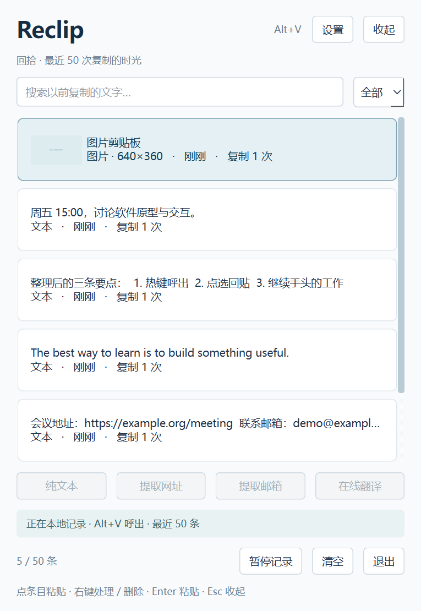

# Reclip

剪贴板时间机器。Windows 单 EXE 便携版，PyQt6 + SQLite。

**[下载最新版 Windows EXE](https://github.com/alyahromagnoli-create/Reclip/releases/latest)** · [详细使用说明](docs/USER_GUIDE.zh-CN.md)

当前版本：**1.0.2**。无需安装 Python 或开发库，不要求电脑存在 D 盘。

## 功能

- 按住顶部 Reclip 标题或其旁空白处可向任意方向拖动窗口；设置/收起按钮仍独立操作。
- 各类子弹窗置于浮窗上方，关闭后可继续操作主界面。
- 自定义全局热键，默认 Alt+V；冲突时提示手动配置，不自动换绑。
- 最近 50 条文本/图片历史、内容去重、搜索与类型筛选。
- 点选历史后尝试恢复原窗口并粘贴，失败时保留到剪贴板供手动 Ctrl+V。
- 纯文本清洗、网址/邮箱提取与可编辑结果预览。
- 暂停记录、删除、清空、托盘驻留；退出使用按钮/托盘，不占用 Ctrl+Q。



## 使用与数据

下载 Release 中的 `Reclip.exe`，放在可写文件夹后双击。首次解包需要几秒，解包使用 Windows 系统临时目录，程序退出后由运行时清理。

全新使用只需 EXE。保留已有记录时，先退出旧版，再把 EXE 和旁边的 **data** 文件夹一起移动或备份。持续修改的数据独立存储，不能永久写回 EXE。本仓库和下载包不包含真实个人记录。

历史未加密，可能含私人内容，请按需暂停或清空；启动不会采集已有剪贴板。网页翻译经确认后仅把当前一条文字打开到 Bing，需联网，无离线翻译模型。图片回贴要求目标软件支持图片；管理员窗口或特殊控件可能限制模拟输入。

## 验证范围

本版 26 项核心、弹窗和拖动测试通过。打包后的 EXE 在独立中文空格路径下验证了设置、纯文本、网址/邮箱提取、文字/图片预览、确认弹窗层级，以及顶部四方向拖动和关闭弹窗后的主界面恢复。此次使用暂停记录的合成数据库，不读写系统剪贴板，不触发全局快捷键。原有跨盘便携和粘贴功能另有前版验证；未因本次修复而声称重新完成全部剪贴板/全局热键实测。发布 EXE 与对应 Python 核心源码已核对。

目前仅在本机 Windows 11 x64 验证；尚未在第二台实体电脑、Windows 10 或其他架构实机验证。程序未签名。

## 从源码构建

Windows x64 + Python 3.12：

```powershell
py -3.12 -m venv .venv
.\.venv\Scripts\python.exe -m pip install -r requirements.txt
.\build.ps1
```

构建缓存和中间文件放在项目内的 work，输出路径见构建脚本。EXE 仅作为 Release 附件发布。

## 许可

原始应用与图标：**GPL-3.0-or-later**，见 [LICENSE](LICENSE)。第三方组件保留各自许可，相关原文随源码或便携包附带。
